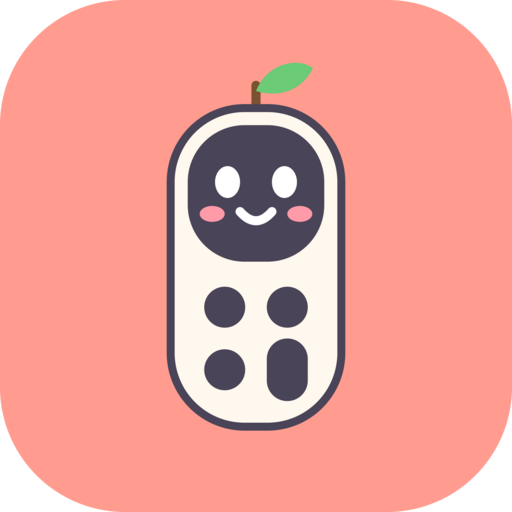
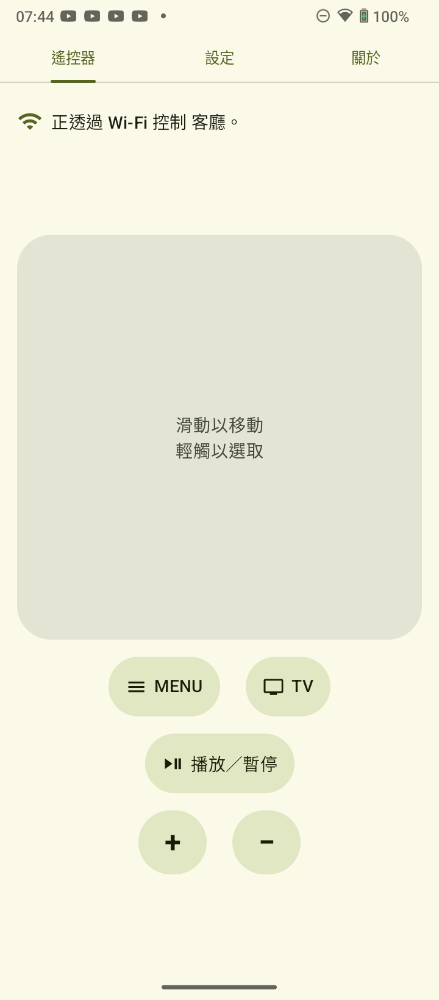
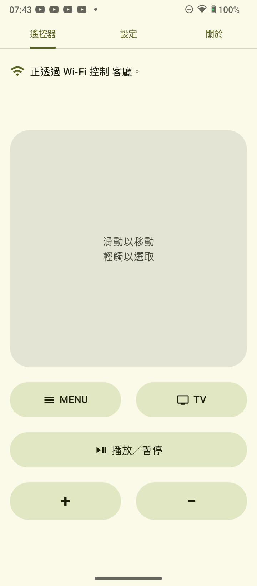
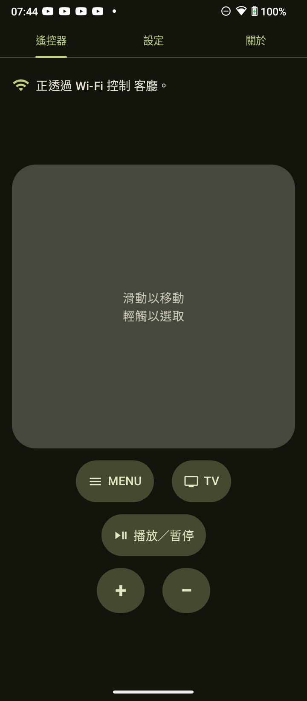
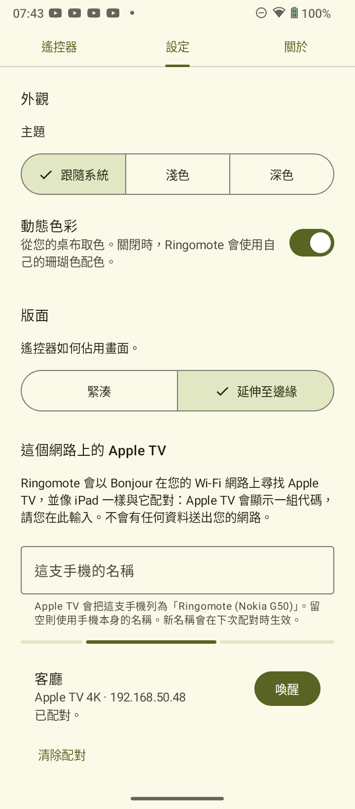
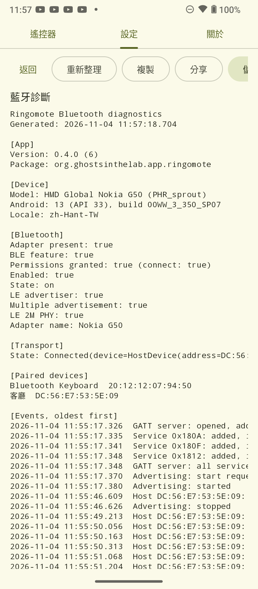

<p align="center"></p>

# Ringomote

An Android app that turns your phone into a remote for Apple TV, compatible with the Siri Remote (1st generation).

一個將您的手機變成 Apple TV 遙控器的 Android 程式，與 Siri Remote（第 1 代）相容。

## Status 開發狀態

Ringomote is ready for everyday use. Pairing with a real Apple TV, reconnection after the app restarts or the Apple TV wakes, and every control (touch surface, Menu, TV/Home, Play/Pause, Volume, Mute) have been verified on hardware, including holding the TV button to open Control Center. Siri voice input is not reproduced.

Ringomote 已可供日常使用。與實際的 Apple TV 配對、App 重新啟動或 Apple TV 喚醒後的重新連線，以及所有操作（觸控表面、Menu、TV／主畫面、播放／暫停、音量、靜音）都已在實機上驗證可行，包括長按 TV 鍵開啟控制中心。Siri 語音輸入則無法重現。

## Screenshots 螢幕截圖

<p align="center">





</p>

Left to right: the remote in the compact and spread-out layouts and in the dark theme, the Settings tab, and the Bluetooth diagnostics report. Taken on a Nokia G50 with dynamic colour on, so the palette follows the wallpaper.

由左至右：緊湊與延伸至邊緣版面的遙控器、深色主題、「設定」分頁，以及藍牙診斷報告。於 Nokia G50 上擷取，開啟了動態色彩，因此配色跟隨桌布。

## How it works 運作方式

The phone talks to the Apple TV directly over Bluetooth Low Energy, presenting itself as a Bluetooth input device (a HID over GATT keyboard), just as the physical remote does. No Wi-Fi network, Apple account or bridge device is involved. The one exception is opt-in and exists because a sleeping Apple TV does not listen for Bluetooth (and ignores Wake-on-LAN packets): Settings > Network can find Apple TVs on the local network with Bonjour and pair with one over Apple's Companion Link protocol, the same link the iOS remote uses, after which a Wake button turns it on. It is off by default, the pairing is a separate PIN step on the Apple TV, and the app never contacts anything beyond the local network.

While the remote is started, a quiet notification keeps it available in the background. It is there because a Bluetooth keyboard must not vanish when its app leaves the screen: if it did, tvOS would drop it and need the link made afresh. Stop from the notification ends the remote until the next launch.

In more detail:

1. **Advertising.** While Ringomote is open, the phone advertises the standard Bluetooth HID service, so the Apple TV lists it under Settings > Remotes and Devices > Bluetooth, next to keyboards and game controllers. (Classic Bluetooth would not work here: Android reports the phone's device class as "phone", which tvOS filters out, and an app cannot change that.)
2. **Pairing.** The Apple TV connects, reads the phone's HID report descriptor (the document that says "I am a keyboard with these keys and media controls"), and the two devices pair with an encrypted, bonded link. From then on the Apple TV reconnects by itself.
3. **Controls.** Every control becomes a standard HID key press, followed by a release, sent as a notification over the link:
   - Touch surface: swipes become the arrow keys, a tap becomes Enter (Select).
   - Menu: Escape, which tvOS treats as "back".
   - TV: the same consumer-control usage the Siri Remote's TV button sends ("Data On Screen"), so tvOS treats a tap as Home and a hold as Control Center.
   - Play/Pause, Volume up, Volume down and Mute: the matching consumer-control usages, as on a media keyboard. Mute comes from the 2nd-generation Siri Remote.

tvOS already knows how to drive its interface from a Bluetooth keyboard, so the phone needs no companion app or special protocol on the Apple TV side. Siri voice input is not reproduced, because the Siri Remote streams voice over its own protocol.

手機透過藍牙低功耗直接與 Apple TV 連線，像實體遙控器一樣以藍牙輸入裝置（HID over GATT 鍵盤）的身分出現，不需經過 Wi-Fi 網路、Apple 帳號或其他橋接裝置。唯一的例外需要您自行開啟，原因是 Apple TV 睡眠時不接收藍牙（也不理會 Wake-on-LAN 封包）：「設定 > 網路」可以用 Bonjour 在區域網路上尋找 Apple TV，並透過 Apple 的 Companion Link 協定（iOS 遙控器使用的同一條連線）與它配對，之後就有「喚醒」按鈕可以把它開啟。此功能預設關閉，配對是在 Apple TV 上另外輸入 PIN 的步驟，本程式也絕不會連線到區域網路以外的任何地方。

詳細一點來說：

1. **廣播。** Ringomote 開啟時，手機會廣播標準的藍牙 HID 服務，因此 Apple TV 會在「設定 > 遙控器與裝置 > 藍牙」中，把它和鍵盤、遊戲控制器列在一起。（傳統藍牙在這裡行不通：Android 將手機的裝置類別回報為「電話」，tvOS 會把它濾掉，而應用程式無法更改這一點。）
2. **配對。** Apple TV 連線後，會讀取手機的 HID 報告描述元（一份說明「我是一個鍵盤，有這些按鍵與媒體控制」的文件），然後雙方建立加密且已配對的連線。之後 Apple TV 會自動重新連線。
3. **操作。** 每個操作都會變成標準的 HID 按鍵按下與放開，以通知的形式透過連線送出：
   - 觸控表面：滑動對應方向鍵，輕觸對應 Enter（選取）。
   - Menu：Escape，tvOS 將它視為「返回」。
   - TV：與 Siri Remote 的 TV 鍵相同的消費性控制用途（「Data On Screen」），因此 tvOS 會把點按視為主畫面、長按視為控制中心。
   - 播放／暫停、音量加、音量減與靜音：對應的消費性控制用途，和多媒體鍵盤相同。靜音鍵來自第二代 Siri Remote。

tvOS 本來就知道如何用藍牙鍵盤操作介面，所以 Apple TV 那一端不需要任何配套程式或特殊協定。Siri 語音輸入沒有重現，因為 Siri Remote 是用自己的協定傳送語音的。

## Requirements 使用需求

- An Android phone running Android 9 (API 28) or later, with Bluetooth.
- An Apple TV that works with the Siri Remote (1st generation) or Bluetooth input devices.

- 執行 Android 9（API 28）以上版本、具備藍牙功能的 Android 手機。
- 可搭配 Siri Remote（第 1 代）或藍牙輸入裝置使用的 Apple TV。

## Pairing 配對

1. Open Ringomote and allow the Bluetooth permissions it asks for. The phone starts advertising itself as a remote right away (the pairing details open by themselves until the first connection; otherwise tap **Details**).
2. On the Apple TV, open **Settings > Remotes and Devices > Bluetooth** and pick your phone.
3. On the phone, accept the pairing request. A second prompt follows: open the notification shade, tap the Bluetooth pairing notification, check that the 6-digit code matches the one on the TV and tap **Pair**. The Apple TV then shows the phone as connected.
4. Once paired, the Apple TV reconnects by itself whenever it is awake and Ringomote is open. If it does not, tap **Connect** next to the Apple TV under **Details**.

1. 開啟 Ringomote，並允許它要求的藍牙權限。手機會立刻以遙控器的身分開始廣播（首次連線前，配對說明會自動展開；否則請點選「詳細資訊」）。
2. 到 Apple TV 開啟「設定 > 遙控器與裝置 > 藍牙」，選擇您的手機。
3. 在手機上接受配對要求。接著還有第二個提示：請拉下通知列，點選藍牙配對通知，確認 6 位數的配對碼與電視上顯示的一致，然後點選「配對」。Apple TV 隨即會顯示手機已連線。
4. 配對完成後，只要 Apple TV 醒著且 Ringomote 開啟中，Apple TV 就會自動重新連線。若沒有，請在「詳細資訊」中點選 Apple TV 旁的「連線」。

## Building 建置

Requirements: Android SDK (compile SDK 37). Gradle provisions the JDK it runs on automatically (see `gradle/gradle-daemon-jvm.properties`).

需求：Android SDK（compile SDK 37）。Gradle 會自動取得執行所需的 JDK（請見 `gradle/gradle-daemon-jvm.properties`）。

```bash
./gradlew :app:assembleDebug        # Debug APK → app/build/outputs/apk/debug/
./gradlew :app:installDebug         # Install on a connected phone 安裝至已連接的手機
./gradlew :app:testDebugUnitTest    # JVM unit tests 單元測試
./gradlew :app:lintDebug            # Lint
```

The Android emulator cannot act as a Bluetooth input device, so testing remote control needs a physical phone and an Apple TV.

Android 模擬器無法作為藍牙輸入裝置，因此測試遙控功能需要實體手機與 Apple TV。

## Trademarks 商標

Apple, Apple TV, Siri and Siri Remote are trademarks of Apple Inc., registered in the U.S. and other countries. Android is a trademark of Google LLC. The Bluetooth® word mark and logos are registered trademarks owned by Bluetooth SIG, Inc. Ringomote is an independent project and is not affiliated with, sponsored or endorsed by any of them. These names are used only to describe compatibility and the technologies the app uses.

Apple、Apple TV、Siri 與 Siri Remote 為 Apple Inc. 在美國及其他國家註冊的商標。Android 為 Google LLC 的商標。Bluetooth® 文字商標與標誌為 Bluetooth SIG, Inc. 所有的註冊商標。Ringomote 為獨立專案，與上述公司並無關聯，亦未獲其贊助或認可；這些名稱僅用於說明相容性及本程式使用的技術。

## Third-party notices 第三方聲明

Ringomote uses open-source libraries, mostly under the Apache License 2.0. See [NOTICES.md](NOTICES.md) for the full list.

Ringomote 使用多項開放原始碼函式庫（大多以 Apache License 2.0 授權）。完整清單請見 [NOTICES.md](NOTICES.md)。

## License 授權

Ringomote is free software, released under the [GNU General Public License, version 3 or later](LICENSE). Third-party components keep their own licenses, as listed in [NOTICES.md](NOTICES.md).

Ringomote 是自由軟體，以 [GNU 通用公共授權第 3 版或其後版本](LICENSE)釋出。第三方元件則各依其原本的授權條款，詳見 [NOTICES.md](NOTICES.md)。
